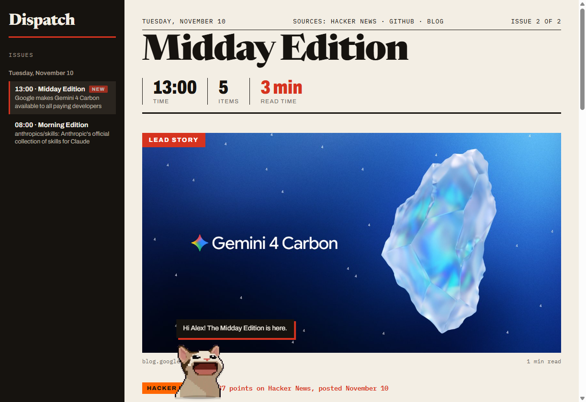

<p align="center">
  
</p>

<p align="center"><b>Your personal newsroom.</b> Claude writes a short, illustrated news issue a few times a day, picked from your own projects. A small desktop app shows it.</p>

<p align="center">
  <a href="LICENSE"></a>
  
  
  
</p>

<p align="center">
  
</p>


News feeds are the same for everybody. Dispatch is not. It reads **your own project folders** and picks the news that matters to what *you* build.

- **Made from your projects.** The editor looks at your READMEs, manifest files and agent instruction files, and writes an honest line for every item: *why it matters to you*. If there is no link to your work, it says so.
- **Works with whatever you work with.** Claude Code, Cursor, Windsurf, Copilot or a plain editor: Dispatch does not hook into your tool. It reads your project folders, so the news follows your projects, not your editor.
- **Claude is the editor, the app only shows.** Scheduled Claude runs write each issue as a small JSON file. The app has no AI inside: no API key, no account, no backend.
- **Short on purpose.** One lead story and a few briefs, with images, in plain language, about five minutes to read. Built so you actually read it every day.
- **Yours in every way.** Language, schedule, sources, length and tone are plain files. Change them by hand or just ask Claude.

| Area | What you get |
| --- | --- |
| **Magazine view** | Lead story, numbered briefs, images, reading progress bar, archive sidebar, light paper look |
| **Issues** | One file per issue (`YYYY-MM-DD-HHMM.json`), three a day by default, a `NEW` badge, and a notice when a scheduled issue is still missing |
| **Images** | Linked in the issue, cached on disk after the first view, so old issues stay readable offline |
| **Personal** | `dispatch.config.json`, your own `profile.md` and an automatic scan of your project folders |
| **Languages** | The issues can be written in any language Claude writes. The interface ships in English and German and is easy to extend |
| **Quality checks** | `npm run check` validates the schema, rejects repeated links and tests every image before an issue counts |
| **Plain files** | JSON for the app and a Markdown copy of every issue for any editor or notes tool |
| **A cat** | A pixel cat walks along the bottom and reads out the lead story when you click it |


<p align="center">
  
</p>

```
 your project folders ──► npm run scan ──► profile/generated.md ─┐
 profile/profile.md (what you write yourself) ───────────────────┤
                                                                 ▼
 scheduled Claude run ──► reads EDITORIAL.md + your profile ──► researches GitHub Trending, Hacker News, your sources
                                                                 │
                       npm run check (schema, links, images) ◄───┘
                                                                 │
                                          issues/2026-11-11-0800.json
                                                                 ▼
                                                   Dispatch app (Electron)
```

| Piece | Job |
| --- | --- |
| [`EDITORIAL.md`](EDITORIAL.md) | The standing instruction for the editor. Plain Markdown, edit it to change the voice |
| `dispatch.config.json` | Language, schedule, length, sources, interests, project folders |
| `npm run scan` | Reads your project folders and writes `profile/generated.md` |
| `npm run check` | Validates the issue the editor just wrote and writes its Markdown copy |
| `npm run reported` | Lists links from the last days so the editor does not repeat itself |
| `app/` | The Electron window. It reads the `issues` folder and shows it |


You need [Node.js](https://nodejs.org) 20 or newer.

```bash
git clone https://github.com/ShadowSatoshiii/Dispatch.git
cd Dispatch
npm install
npm start
```

The app opens with two sample issues and says so at the top. Your first real issue replaces them as soon as the editor has written it.

**Make it yours in three steps:**

```bash
cp dispatch.config.example.json dispatch.config.json      # your settings
npm run scan -- "C:\code\my-shop" "C:\code\my-cli"          # optional: let Dispatch learn what you build
npm run schedule                                           # prints the cron line and the prompt for the scheduled task
```

On Windows, `npm run desktop` also puts a **Dispatch** shortcut with its own icon on your desktop.

**Try it without a schedule.** Open Claude in this folder and say: *"Follow EDITORIAL.md and write the next issue."* Claude researches, writes `issues/<id>.json` and runs the check.


### Settings

Everything lives in `dispatch.config.json` (copy it from `dispatch.config.example.json`). The file is not committed to Git. Restart the app after you change it.

| Setting | Default | What it does |
| --- | --- | --- |
| `language` | `"English"` | The language the **issues** are written in. Any language Claude writes |
| `uiLanguage` | `"auto"` | The language of the **app**: `"auto"` (follow the system), `"en"`, `"de"` or your own |
| `userName` | `""` | Optional. The cat greets you by name |
| `schedule` | `["08:00","13:00","19:00"]` | When issues are written, in local time. The app uses it to notice a missing issue |
| `issuesDir` | `"issues"` | Where the issues are stored |
| `items` | `{ "min": 4, "max": 6 }` | How many items an issue has, lead story included |
| `sources` | GitHub Trending and Hacker News on | Switch the built-in sources on or off, add your own pages in `extra` |
| `projects` | `[]` | Project folders for `npm run scan` |
| `interests` | `[]` | Topics to favour, such as `["Rust", "local AI tools"]` |

### Your profile

`dispatch` reads two files in `profile/`:

- **`profile.md`** is written by you: what you build, what you want to hear about, what you do not care about, your tone. Start from [`profile/profile.example.md`](profile/profile.example.md). It wins over everything generated.
- **`generated.md`** is written by `npm run scan` from your project folders: language and dependencies from manifest files (`package.json`, `requirements.txt`, `Cargo.toml`, `go.mod` and more), which AI tools a project uses, and the start of the README and the agent instruction file.

The scan reads only those files. It never opens `.env` files, removes credential-like lines and e-mail addresses, and writes plain text you can read and edit. Both files stay on your machine and are ignored by Git.

### Ask Claude

All of this is plain files, so personalising Dispatch is a normal conversation with Claude. Open Claude in this folder and say things like:

> *Add my two projects in `C:\code\my-shop` and `C:\code\my-cli` to the config and run the scan.*
>
> *Make the issues shorter: three to four items, two sentences each.*
>
> *Write in a more casual tone, and never include cryptocurrency news.*
>
> *Drop Hacker News and add this blog feed as a source: `https://example.com/feed.xml`.*
>
> *Only give me news about Rust and local AI tools.*

Claude edits `dispatch.config.json`, `profile/profile.md` or `EDITORIAL.md` for you. The next scheduled run follows the new rules.


Two settings, two different things:

| Setting | Controls | Example |
| --- | --- | --- |
| `language` | The language of the **news**: titles, summaries and the *why it matters to you* line | `"German"`, `"Spanish"`, `"Japanese"` |
| `uiLanguage` | The language of the **app**: buttons, labels and what the cat says | `"de"` |

```json
{ "language": "German", "uiLanguage": "de", "userName": "Alex" }
```

The issues are written by Claude, so `language` can be any language Claude writes. The app itself ships in **English** and **German**. To add another interface language:

1. Copy `locales/en.json` to `locales/<code>.json`, for example `locales/fr.json`.
2. Translate the values and keep the keys. (Or ask Claude: *"Translate locales/en.json into French as locales/fr.json."*)
3. Set `"uiLanguage": "fr"` and restart the app.

Texts you leave out fall back to English, so a partial translation already works. A pull request with a new language is very welcome.


Run `npm run schedule`. It prints the **cron expression** for your times and the **prompt** for the task, with the path of this folder already filled in. Then, in the Claude desktop app:

1. Create a new **scheduled task** (the *Scheduled* section in the sidebar).
2. Paste the prompt.
3. Use the cron expression as the schedule, in local time.
4. Set this folder as the task's working folder.

A few honest notes:

- Scheduled tasks run while the Claude desktop app is open. If the app was closed at the scheduled time, the run is caught up on the next launch, and the issue gets the time of its slot.
- Every run uses your Claude plan like any other session. Three runs a day can reach the usage limit on a smaller plan, especially when you work with Claude in between. A run that hits the limit writes nothing and leaves the slot empty. If that happens to you, use fewer times in `schedule`.
- Tested with scheduled tasks in the Claude desktop app. Any scheduler that can start Claude in this folder with the prompt should work too, but that is not tested here.

## Privacy

- Dispatch has **no server, no account and no telemetry**. Issues are files in your `issues` folder.
- The app makes network requests only to load the images that an issue links to, and only to public web addresses (addresses on your own machine or network are refused).
- The editor, which is Claude running in your own session, reads `dispatch.config.json`, your profile and the research pages. Read `profile/generated.md` once before the first run and delete what you do not want used.
- `dispatch.config.json`, `profile/profile.md`, `profile/generated.md` and `issues/` are in `.gitignore`, so your personal feed does not end up in a public repository by accident.

## Project layout

| Folder | Contents |
| --- | --- |
| `app/` | The Electron window and its page: HTML, CSS, JavaScript, fonts, the cat |
| `src/` | The shared logic: config, issues, image cache, interface texts, checks, project scan, schedule |
| `tools/` | The command line tools behind `npm run scan`, `check` and `reported` |
| `locales/` | Interface texts, one file per language |
| `samples/` | Two sample issues shown until your first real one exists |
| `profile/` | The example profile. Your own `profile.md` and `generated.md` go here |
| `issues/` | Your issues. Created by the editor, not committed |
| `scripts/` | Desktop shortcut, schedule helper, Electron repair, artwork generators |
| `test/` | Tests: `npm test` |

## Troubleshooting

- **`npm start` says Electron is not installed, although `npm install` finished.** Some very new Node versions (seen with Node 26) download Electron but silently fail to unpack it. On Windows run `npm run fix-electron`, which unpacks the archive from Electron's cache. The more lasting fix is a Node LTS version (22 or 20) and `npm install` again.
- **npm warns about install scripts.** Newer npm versions block install scripts until they are approved. `package.json` already approves the one that Electron needs (`allowScripts`).
- **The app shows sample issues.** No real issue exists yet. Run the editor once (see *Try it without a schedule*).
- **A run wrote nothing.** Check whether the usage limit of your Claude plan was reached, then run it again.
- **Notifications.** New-issue notifications use Electron's notification API. They are not verified on every system.
- **macOS and Linux.** Electron is cross-platform and `npm start` should work, but Dispatch has only been tested on Windows. The desktop shortcut and the Electron repair are Windows only.

## Roadmap

- Tested builds for macOS and Linux, and a packaged installer
- More source types, such as RSS and newsletters
- A watchlist: releases of the repositories and people you care about
- Search across all issues
- More interface languages

Ideas and pull requests are welcome. See [CONTRIBUTING.md](CONTRIBUTING.md).

## Credits & license

Dispatch is free software, licensed under the **GNU General Public License v3.0**. See [LICENSE](LICENSE).

Built with [Electron](https://www.electronjs.org) (MIT). The fonts [Archivo](https://fonts.google.com/specimen/Archivo), [Newsreader](https://fonts.google.com/specimen/Newsreader) and [IBM Plex Mono](https://fonts.google.com/specimen/IBM+Plex+Mono) are licensed under the SIL Open Font License 1.1, see [`app/ui/fonts/OFL.txt`](app/ui/fonts/OFL.txt). The logo and the README artwork are drawn from code (`scripts/make-assets.js` and `scripts/make-readme-art.js`). The pixel cat in `app/ui/assets` was supplied by the author.

The two sample issues summarize public web pages in their own words and link to the originals. The images in them are loaded from their original sources and are not stored in this repository.

<p align="center">
  <a href="https://github.com/ShadowSatoshiii"></a>
</p>
